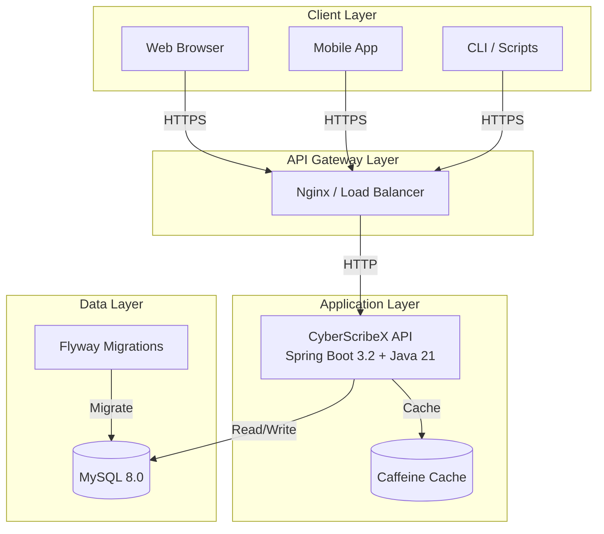
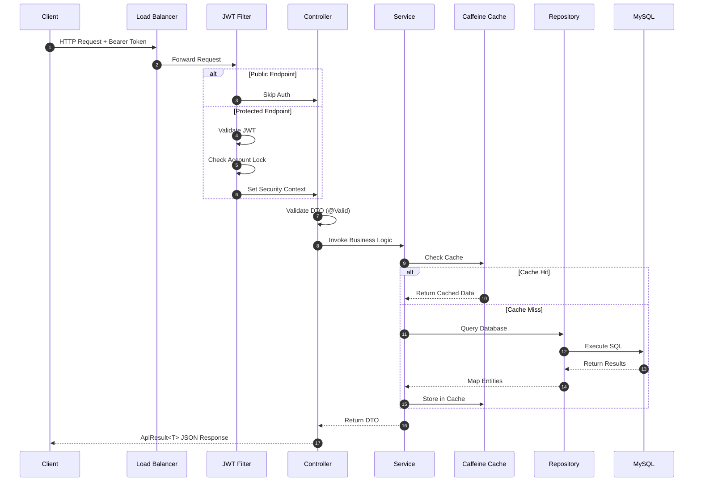
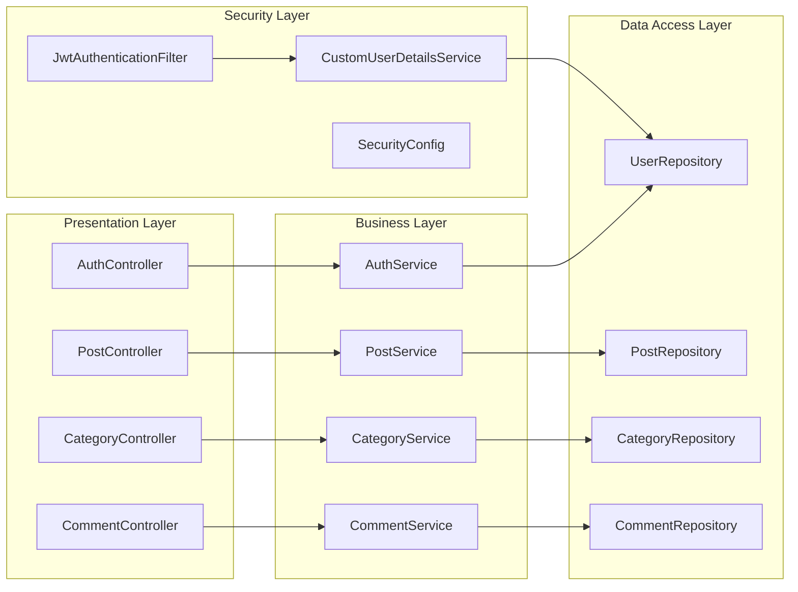
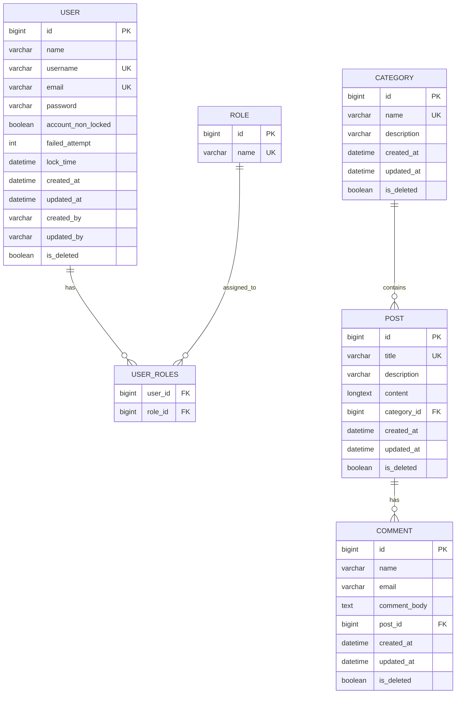
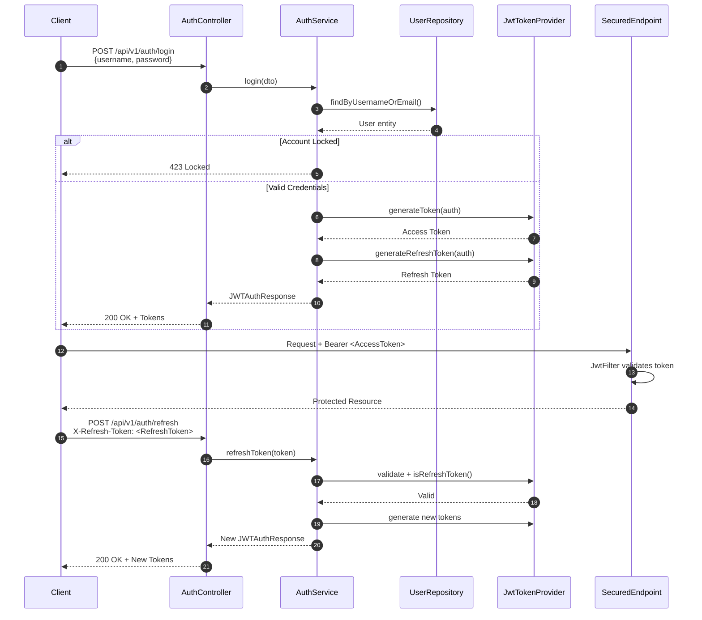
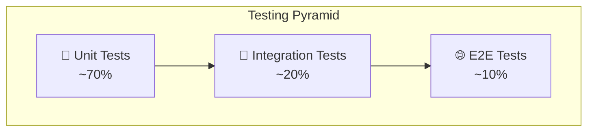
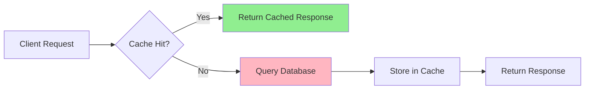

<div align="center">

# 🚀 CyberScribeX

**Production-Grade Blogging Platform REST API**

[](https://openjdk.org/projects/jdk/21/)
[](https://spring.io/projects/spring-boot)
[](https://maven.apache.org/)
[](https://opensource.org/licenses/Apache-2.0)

> A comprehensive, enterprise-ready blogging platform demonstrating elite Java backend engineering practices.

[Features](#-features) • [Architecture](#-architecture) • [Getting Started](#-getting-started) • [API Docs](#-api-documentation) • [Security](#-security-architecture)

</div>

---

## 📖 Table of Contents

- [Overview](#-overview)
- [Architecture](#-architecture)
- [Tech Stack](#-tech-stack)
- [Project Structure](#-project-structure)
- [Features](#-features)
- [Database Schema](#-database-schema)
- [Security Architecture](#-security-architecture)
- [Getting Started](#-getting-started)
- [Environment Configuration](#-environment-configuration)
- [API Documentation](#-api-documentation)
- [Testing Strategy](#-testing-strategy)
- [Deployment](#-deployment)
- [Performance & Caching](#-performance--caching)
- [Monitoring](#-monitoring)
- [Contributing](#-contributing)
- [License](#-license)

---

## 🎯 Overview

CyberScribeX is a **production-grade REST API** for a blogging platform, engineered with enterprise-level standards. It serves as both a functional application and a **reference implementation** for modern Java backend development.

### What Makes This Production-Grade?

| Aspect | Implementation |
|--------|---------------|
| **Security** | JWT with refresh tokens, BCrypt (strength 12), account lockout, CORS, RBAC |
| **Data Integrity** | Flyway migrations, JPA auditing, soft deletes, optimistic locking |
| **API Design** | Standardized response wrappers, HATEOAS-ready, comprehensive OpenAPI docs |
| **Performance** | Caffeine caching, database indexing, connection pooling (HikariCP) |
| **Observability** | Actuator health/metrics, structured logging, distributed trace IDs |
| **Testing** | Unit tests (Mockito), integration tests (H2), Testcontainers support |
| **DevOps** | Multi-stage Docker build, Docker Compose, Makefile, profile-based configs |

---

## 🏗 Architecture

### High-Level System Architecture



### Request Flow Architecture



### Layered Application Architecture



---

## 🛠 Tech Stack

### Core Framework
| Technology | Version | Purpose |
|-----------|---------|---------|
| Java | 21 | Language (Virtual Threads, Pattern Matching) |
| Spring Boot | 3.2.4 | Application Framework |
| Spring Security | 6.2 | Authentication & Authorization |
| Spring Data JPA | 3.2 | Data Persistence |
| Hibernate | 6.4 | ORM |

### Security & Auth
| Technology | Version | Purpose |
|-----------|---------|---------|
| JJWT | 0.12.3 | JWT Token Handling |
| BCrypt | - | Password Hashing (Strength 12) |

### Data & Migration
| Technology | Version | Purpose |
|-----------|---------|---------|
| MySQL Connector | 8.0 | Database Driver |
| Flyway | 10.x | Schema Migrations |
| HikariCP | 5.x | Connection Pooling |

### Utilities & Mapping
| Technology | Version | Purpose |
|-----------|---------|---------|
| MapStruct | 1.5.5 | Compile-time DTO Mapping |
| Lombok | 1.18.30 | Boilerplate Reduction |
| Apache Commons Lang | 3.14 | Utility Functions |

### Documentation & Monitoring
| Technology | Version | Purpose |
|-----------|---------|---------|
| SpringDoc OpenAPI | 2.3.0 | Swagger UI / API Docs |
| Spring Boot Actuator | 3.2 | Health & Metrics Endpoints |
| Micrometer | 1.12 | Metrics Collection |

### Testing
| Technology | Version | Purpose |
|-----------|---------|---------|
| JUnit 5 | 5.10 | Unit Testing |
| Mockito | 5.11 | Mocking Framework |
| REST Assured | 5.4 | API Integration Testing |
| H2 Database | 2.2 | In-Memory Test DB |
| Testcontainers | 1.19 | Containerized Integration Tests |

---

## 📁 Project Structure

```
CyberScribeX/
├── src/
│   ├── main/
│   │   ├── java/com/xoraus/cyberscribex/
│   │   │   ├── config/              # Configuration classes
│   │   │   │   ├── AuditorAwareImpl.java
│   │   │   │   ├── CacheConfig.java
│   │   │   │   ├── JpaAuditingConfig.java
│   │   │   │   └── SecurityConfig.java
│   │   │   ├── controller/          # REST API controllers
│   │   │   │   ├── AuthController.java
│   │   │   │   ├── CategoryController.java
│   │   │   │   ├── CommentController.java
│   │   │   │   └── PostController.java
│   │   │   ├── entity/              # JPA entities with auditing
│   │   │   │   ├── Auditable.java   # Base entity (createdAt, updatedAt, soft delete)
│   │   │   │   ├── Category.java
│   │   │   │   ├── Comment.java
│   │   │   │   ├── Post.java
│   │   │   │   ├── Role.java
│   │   │   │   └── User.java
│   │   │   ├── exception/           # Global exception handling
│   │   │   │   ├── CyberScribeXAPIException.java
│   │   │   │   ├── GlobalExceptionHandler.java
│   │   │   │   └── ResourceNotFoundException.java
│   │   │   ├── mapper/              # MapStruct mappers (compile-time)
│   │   │   │   ├── CategoryMapper.java
│   │   │   │   ├── CommentMapper.java
│   │   │   │   └── PostMapper.java
│   │   │   ├── payload/             # DTOs & Response Wrappers
│   │   │   │   ├── ApiResult.java   # Standardized API response
│   │   │   │   ├── CategoryDto.java
│   │   │   │   ├── CommentDto.java
│   │   │   │   ├── ErrorResponse.java
│   │   │   │   ├── JWTAuthResponse.java
│   │   │   │   ├── LoginDto.java
│   │   │   │   ├── PostDto.java
│   │   │   │   ├── PostResponse.java
│   │   │   │   └── RegisterDto.java
│   │   │   ├── repository/          # Spring Data JPA repositories
│   │   │   ├── security/            # JWT & Security components
│   │   │   │   ├── CustomUserDetailsService.java
│   │   │   │   ├── JwtAuthenticationEntryPoint.java
│   │   │   │   ├── JwtAuthenticationFilter.java
│   │   │   │   └── JwtTokenProvider.java
│   │   │   ├── service/             # Service interfaces
│   │   │   └── service/impl/        # Service implementations
│   │   └── resources/
│   │       ├── application.properties       # Base configuration
│   │       ├── application-dev.properties   # Development profile
│   │       ├── application-qa.properties    # QA/Staging profile
│   │       ├── application-prod.properties  # Production profile
│   │       └── db/migration/                # Flyway SQL migrations
│   │           ├── V1__init_schema.sql
│   │           └── V2__seed_data.sql
│   └── test/                        # Unit & Integration tests
├── Dockerfile                       # Multi-stage Docker build
├── docker-compose.yml               # Local development stack
├── Makefile                         # Common development commands
└── pom.xml                          # Maven build configuration
```

---

## ✨ Features

### Post Management
- ✅ Create, read, update, delete blog posts
- ✅ Associate posts with categories
- ✅ Full-text search across title, description, and content
- ✅ Paginated listing with sorting support
- ✅ Soft delete implementation (data retention)

### Category Management
- ✅ Create, read, update, delete categories
- ✅ Duplicate name prevention
- ✅ Category-post relationship integrity

### Comment Management
- ✅ Add comments to posts
- ✅ Retrieve comments by post
- ✅ Comment ownership validation

### Authentication & Authorization
- ✅ JWT-based stateless authentication
- ✅ Access tokens (15 min) + Refresh tokens (7 days)
- ✅ Role-based access control (RBAC) — ADMIN / USER
- ✅ Account lockout after 5 failed attempts (30-min cooldown)
- ✅ Strong password enforcement (uppercase, lowercase, digit, special char)
- ✅ CORS configuration for cross-origin requests

---

## 🗄 Database Schema

### Entity Relationship Diagram



### Design Decisions

| Decision | Rationale |
|----------|-----------|
| **Soft Deletes** | `@SQLDelete` + `@SQLRestriction` preserves data for audit/compliance |
| **JPA Auditing** | Automatic `created_at`, `updated_at`, `created_by`, `updated_by` tracking |
| **Database Indexes** | Strategic indexes on foreign keys, unique fields, and soft-delete flags |
| **Foreign Keys** | Named constraints with proper `ON DELETE` rules for referential integrity |
| **Flyway Migrations** | Version-controlled schema evolution; `ddl-auto=validate` in production |

---

## 🔐 Security Architecture

### JWT Authentication Flow



### Security Matrix

| Endpoint | GET | POST | PUT | DELETE |
|----------|-----|------|-----|--------|
| `/api/v1/auth/**` | — | Public | — | — |
| `/api/v1/posts` | Public | ADMIN | — | — |
| `/api/v1/posts/{id}` | Public | — | ADMIN | ADMIN |
| `/api/v1/posts/search` | Public | — | — | — |
| `/api/v1/categories` | Public | ADMIN | — | — |
| `/api/v1/categories/{id}` | Public | — | ADMIN | ADMIN |
| `/api/v1/comments/**` | Public | Public | Public | Public |
| `/actuator/health` | Public | — | — | — |
| `/actuator/metrics` | Authenticated | — | — | — |

---

## 🚀 Getting Started

### Prerequisites

- **Java 21** (LTS)
- **Maven 3.9+** (or use `./mvnw` wrapper)
- **MySQL 8.0+** (or use Docker Compose)
- **Docker** (optional, for containerized development)

### Quick Start with Docker Compose

```bash
# Clone the repository
git clone https://github.com/xoraus/CyberScribeX.git
cd CyberScribeX

# Start the full stack (App + MySQL)
make docker-run

# Or manually:
docker-compose up -d

# View logs
make docker-logs
```

### Local Development

```bash
# 1. Create MySQL database
mysql -u root -p -e "CREATE DATABASE CyberScribeDB CHARACTER SET utf8mb4 COLLATE utf8mb4_unicode_ci;"

# 2. Set environment variables (or create .env file)
export DB_HOST=localhost
export DB_PORT=3306
export DB_NAME=CyberScribeDB
export DB_USERNAME=root
export DB_PASSWORD=your_password
export JWT_SECRET=$(openssl rand -base64 48)

# 3. Run the application
make dev

# Or manually:
./mvnw spring-boot:run -Dspring-boot.run.profiles=dev
```

### Makefile Commands

```bash
make help           # Show all available commands
make build          # Compile the project
make test           # Run all tests
make test-integration  # Run integration tests
make package        # Build JAR artifact
make dev            # Run in development mode
make prod           # Run in production mode
make docker-build   # Build Docker image
make docker-run     # Run with Docker Compose
make docker-logs    # View application logs
make migrate        # Run Flyway migrations
```

---

## ⚙ Environment Configuration

### Profile-Based Configuration

| Profile | Database | Flyway | Logging | Cache |
|---------|----------|--------|---------|-------|
| **dev** | Local MySQL | Enabled | DEBUG | Caffeine (60m) |
| **qa** | QA MySQL | Enabled | INFO | Caffeine (60m) |
| **prod** | Production MySQL | Enabled | WARN | Caffeine (30m) |
| **test** | H2 In-Memory | Disabled | DEBUG | Disabled |

### Required Environment Variables (Production)

```bash
# Database
DB_HOST=your-db-host
DB_PORT=3306
DB_NAME=CyberScribeDB
DB_USERNAME=cyberscribex
DB_PASSWORD=strong_password

# JWT (generate with: openssl rand -base64 48)
JWT_SECRET=your-base64-encoded-secret-min-256-bits
JWT_EXPIRATION=900000          # 15 minutes
JWT_REFRESH_EXPIRATION=604800000  # 7 days

# Server
SERVER_PORT=8080

# File Uploads
UPLOAD_DIR=/var/lib/cyberscribex/uploads
```

### Security Checklist for Production

- [ ] Change default JWT secret (minimum 256 bits)
- [ ] Use strong database passwords
- [ ] Enable SSL/TLS (HTTPS)
- [ ] Restrict `/actuator` endpoints to internal network
- [ ] Configure log rotation and centralized logging
- [ ] Set up database backups
- [ ] Use secrets management (AWS Secrets Manager, Vault, etc.)

---

## 📚 API Documentation

### Standardized Response Format

All API responses follow a consistent structure:

**Success Response:**
```json
{
  "success": true,
  "message": "Post created successfully",
  "data": {
    "id": 1,
    "title": "Getting Started with Spring Boot",
    "description": "A comprehensive guide",
    "content": "Spring Boot makes it easy...",
    "categoryId": 1
  },
  "timestamp": "2024-01-15T10:30:00Z"
}
```

**Error Response:**
```json
{
  "status": 404,
  "error": "Not Found",
  "message": "Post not found with id : '999'",
  "path": "/api/v1/posts/999",
  "traceId": "a1b2c3d4e5f6",
  "timestamp": "2024-01-15T10:30:00Z"
}
```

**Validation Error:**
```json
{
  "success": false,
  "message": "Validation failed",
  "errors": {
    "title": "Title must be between 3 and 255 characters",
    "email": "Email should be valid"
  },
  "timestamp": "2024-01-15T10:30:00Z"
}
```

### Interactive API Explorer

Once the application is running, access Swagger UI:

```
http://localhost:8080/swagger-ui/index.html
```

### Sample API Calls

```bash
# Register a new user
curl -X POST http://localhost:8080/api/v1/auth/register \
  -H "Content-Type: application/json" \
  -d '{
    "name": "John Doe",
    "username": "johndoe",
    "email": "john@example.com",
    "password": "SecureP@ss123"
  }'

# Login
curl -X POST http://localhost:8080/api/v1/auth/login \
  -H "Content-Type: application/json" \
  -d '{
    "usernameOrEmail": "johndoe",
    "password": "SecureP@ss123"
  }'

# Create a post (ADMIN required)
curl -X POST http://localhost:8080/api/v1/posts \
  -H "Content-Type: application/json" \
  -H "Authorization: Bearer <your-access-token>" \
  -d '{
    "title": "My First Post",
    "description": "A short description",
    "content": "The full content here...",
    "categoryId": 1
  }'

# Search posts
curl "http://localhost:8080/api/v1/posts/search?q=spring"

# Get paginated posts
curl "http://localhost:8080/api/v1/posts?pageNo=0&pageSize=10&sortBy=createdAt&sortDir=desc"
```

---

## 🧪 Testing Strategy

### Testing Pyramid



### Test Organization

| Layer | Framework | Coverage |
|-------|-----------|----------|
| **Unit Tests** | JUnit 5 + Mockito | Services, Mappers, Utilities |
| **Integration Tests** | Spring Boot Test + H2 | Controllers, Repositories |
| **Container Tests** | Testcontainers + REST Assured | Full stack with MySQL |

### Running Tests

```bash
# Run all tests
./mvnw test

# Run only unit tests
./mvnw test -Dtest=*Test

# Run specific test class
./mvnw test -Dtest=PostServiceTest

# Run with coverage
./mvnw test jacoco:report
```

### Sample Unit Test

```java
@ExtendWith(MockitoExtension.class)
@DisplayName("Post Service Unit Tests")
class PostServiceTest {

    @Mock private PostRepository postRepository;
    @Mock private CategoryRepository categoryRepository;
    @Mock private PostMapper postMapper;
    
    @InjectMocks private PostServiceImp postService;

    @Test
    @DisplayName("Should create post successfully")
    void shouldCreatePost() {
        // Given
        given(categoryRepository.findActiveById(1L))
            .willReturn(Optional.of(category));
        given(postMapper.toEntity(postDto))
            .willReturn(post);
        given(postRepository.save(any(Post.class)))
            .willReturn(savedPost);
        
        // When
        PostDto result = postService.createPost(postDto);
        
        // Then
        assertThat(result).isNotNull();
        assertThat(result.getTitle()).isEqualTo("Test Post");
    }
}
```

---

## 🐳 Deployment

### Docker Multi-Stage Build

```dockerfile
# Stage 1: Build
FROM maven:3.9-eclipse-temurin-21-alpine AS builder
WORKDIR /app
COPY pom.xml .
COPY src ./src
RUN mvn clean package -DskipTests -B

# Stage 2: Runtime
FROM eclipse-temurin:21-jre-alpine
RUN addgroup -S cyberscribex && adduser -S cyberscribex -G cyberscribex
WORKDIR /app
COPY --from=builder /app/target/CyberScribeX-1.0.0.jar app.jar
USER cyberscribex
EXPOSE 8080
HEALTHCHECK --interval=30s --timeout=3s \
    CMD wget --spider http://localhost:8080/actuator/health || exit 1
ENTRYPOINT ["java", "-XX:+UseContainerSupport", "-jar", "app.jar"]
```

### Production Deployment Checklist

1. **Build the image:**
   ```bash
   docker build -t cyberscribex:1.0.0 .
   ```

2. **Push to registry:**
   ```bash
   docker tag cyberscribex:1.0.0 your-registry/cyberscribex:1.0.0
   docker push your-registry/cyberscribex:1.0.0
   ```

3. **Run with production profile:**
   ```bash
   docker run -e SPRING_PROFILES_ACTIVE=prod \
     -e DB_HOST=prod-db.internal \
     -e DB_PASSWORD_FILE=/run/secrets/db_password \
     -e JWT_SECRET_FILE=/run/secrets/jwt_secret \
     -p 8080:8080 \
     your-registry/cyberscribex:1.0.0
   ```

---

## ⚡ Performance & Caching

### Caching Architecture



### Cache Configuration

| Cache Name | Strategy | Max Size | TTL |
|-----------|----------|----------|-----|
| `posts` | Page + ID lookup | 1000 | 30 min |
| `categories` | All + ID lookup | 500 | 30 min |
| `postSearch` | Search queries | 500 | 30 min |

### Cache Eviction Rules

- **Create/Update/Delete** operations trigger `@CacheEvict(allEntries = true)`
- Production uses shorter TTL for faster consistency
- Cache statistics available via Actuator metrics

---

## 📊 Monitoring

### Actuator Endpoints

| Endpoint | Access | Description |
|----------|--------|-------------|
| `/actuator/health` | Public | Application health status |
| `/actuator/info` | Public | Build and environment info |
| `/actuator/metrics` | Authenticated | JVM, HTTP, cache metrics |
| `/actuator/prometheus` | Authenticated | Prometheus-compatible metrics |

### Health Indicators

```json
{
  "status": "UP",
  "components": {
    "db": {
      "status": "UP",
      "details": {
        "database": "MySQL",
        "validationQuery": "isValid()"
      }
    },
    "diskSpace": {
      "status": "UP"
    },
    "ping": {
      "status": "UP"
    }
  }
}
```

### Logging Conventions

| Level | Usage |
|-------|-------|
| **ERROR** | Unexpected exceptions, system failures |
| **WARN** | Security events, account lockouts, invalid tokens |
| **INFO** | Business operations (CRUD), authentication success |
| **DEBUG** | SQL queries, request details (dev only) |

All log entries include a **Trace ID** for distributed tracing:
```
[a1b2c3d4e5f6] Resource not found: Post not found with id : '999'
```

---

## 🤝 Contributing

We welcome contributions! Please follow these guidelines:

1. **Fork** the repository
2. **Create a feature branch:** `git checkout -b feature/amazing-feature`
3. **Follow code conventions:**
   - Use meaningful variable names
   - Write unit tests for new features
   - Update API documentation
4. **Commit with clear messages:** `feat: add post search functionality`
5. **Open a Pull Request** with detailed description

### Code Review Checklist

- [ ] All tests pass
- [ ] New code has unit tests
- [ ] API changes are documented in Swagger annotations
- [ ] No sensitive data in logs or responses
- [ ] Flyway migrations are backward-compatible

---

## 📄 License

This project is licensed under the **Apache License 2.0** — see the [LICENSE](LICENSE) file for details.

---

<div align="center">

**Built with ❤️ by [Sajjad Salaria](https://xoraus.github.io)**

*If this project helped you learn or served as a reference, please consider giving it a ⭐*

</div>
